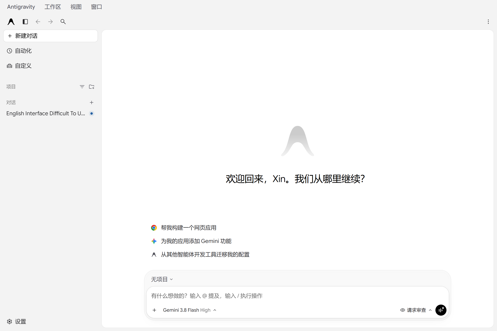
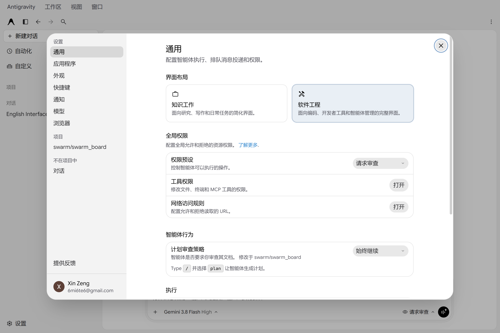

# Antigravity 简体中文汉化插件

给 [Google Antigravity](https://antigravity.google/) 桌面客户端（Electron + 本地 Web UI 架构）注入简体中文界面的汉化插件。

- 纯前端注入，**不改动任何用户数据**
- 支持 SPA 路由切换与 React 重渲染（MutationObserver 持续生效）
- 词条集中在 `package/dist/zhcn.js` 的 `DICT` / `PATTERNS` 里，按需增删
- 一条命令安装、一条命令卸载，自动备份原始 `app.asar`

> 已在 Windows + Antigravity 2.31.2 上实测可用。





## 工作方式

Antigravity 2.x 的界面是一个由本地 `language_server.exe` 提供的 Web 应用，Electron 通过
`resources/app.asar/dist/preload.js` 把它加载到每个窗口里。本插件：

1. 把翻译脚本 `zhcn.js` 放进 `app.asar` 的 `dist/` 目录；
2. 在 `preload.js` 末尾**内联**追加该脚本（沙箱化 preload 不能 `require` 相对路径文件，必须内联）；
3. 顺带把 `menu.js` 里的原生菜单文案（新建窗口 / 放大 / 文档 / 连接到 WSL / 在本地重新打开）替换为中文；
4. 页面加载后由脚本遍历 DOM，做**精确匹配**替换，并用 `MutationObserver` 处理 SPA 路由切换与 React 重渲染；
5. 同时翻译 `placeholder`、`title`、`aria-label`、`alt` 等属性。

安全边界：不改动任何用户数据；跳过输入框、`pre`/`code`、编辑器、含中文的内容以及超长文本，
所以对话标题、代码、用户输入不会被误翻。

## 安装

需要 Node.js 18+。

```bash
git clone https://github.com/h873745811-coder/antigravity-zh-cn.git
cd antigravity-zh-cn
npm install          # 安装 @electron/asar
node install.mjs     # 或 npm run install-zh
```

安装后**完全退出 Antigravity 再重新打开**。首次安装会把原始包备份为
`resources/app.asar.zhcn-backup`。

找不到安装目录时，可以用环境变量指定：

```powershell
$env:ANTIGRAVITY_HOME = "C:\Path\To\antigravity"
node install.mjs
```

## 卸载

```bash
node uninstall.mjs   # 或 npm run uninstall-zh
```

优先用备份完整还原；备份不存在时则移除注入块并重新打包。

## 目录结构

```
antigravity-zh-cn/
├── install.mjs                 安装器（备份 → 解包 → 注入 → 重打包）
├── uninstall.mjs               卸载器（还原备份）
├── package/
│   └── dist/
│       └── zhcn.js             翻译脚本（词条在 DICT 里，按需增删）
├── docs/                       README 用的效果截图
├── LICENSE                     MIT
└── README.md
```

## 扩充词典

编辑 `package/dist/zhcn.js` 中的 `DICT`（英文原文 → 中文），或 `PATTERNS`（正则，用于
“See 7 more”“欢迎回来，Xxx。…”这类带变量的句子），然后重新执行 `node install.mjs`
并重启 Antigravity。

临时关闭翻译（不卸载）：在应用页面控制台执行
`localStorage.setItem('antigravity-zhcn','off')`，重新打开窗口生效；删除该键即恢复。

## 已知限制

- Antigravity 自动更新会覆盖 `app.asar`，汉化随之失效：更新后重新执行一次 `node install.mjs` 即可。
- 应用重启后某些新出现的文案若未被翻译，把原文补进 `DICT` 再重装。
- 仅覆盖界面文案；模型回复、代码、Markdown 内容保持原文。

## 免责声明

本项目与 Google 无关，仅为个人学习用途的界面本地化方案。它通过修改应用自身的
`app.asar` 实现汉化，可能违反 Antigravity 的服务条款，也可能在版本更新后失效。
使用前请自行评估风险，**建议先备份 `resources/app.asar`**。仓库不包含、也不分发
Antigravity 的任何专有代码。

## License

[MIT](LICENSE) © 2026 何善知
